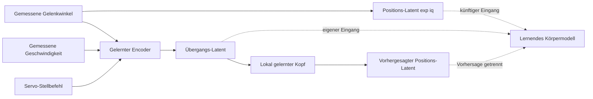

# Nutzerwunsch und Entscheidung

Servopositionen sollen dem Körpermodell als Latent-Information erhalten bleiben, damit später
kein inverses Netz allein zur Rückgewinnung dieser Messung trainiert werden muss. Deshalb
trägt die Schnittstelle einen **expliziten Positionsblock** neben dem gelernten Übergangs-Latent.
Ein Verbraucher muss q nicht aus einem unbeschrifteten, aktionsabhängigen Merkmalsvektor erraten.

Positionsblock: `exp(i*q)` pro gemessenem Gelenkwinkel. Das ist **festgelegte Sensorcodierung,
kein gelerntes Körpermodell**. Sie berechnet keine Handposition, FK oder IK. Diese Zusammenhänge
muss ein Körpermodell weiterhin lernen. Die Codierung ist im unterstützten Bereich reversibel;
ein Körpermodell kann sie direkt verwenden, ohne zuvor nach q zurückzudecodieren.

# Ausgänge und Bedeutung

| Ausgang | Reelle Portdimension | Bedeutung |
|---|---:|---|
| `position_latent` | 10 | Aktuell gemessene Gelenklage als fünf komplexe Einheitsphasen |
| `velocity_rad_s` | 5 | Gemessene Geschwindigkeiten als eigener propriozeptiver Block |
| `transition_latent` | 48 | Gelernte 24-komplexe Merkmale f(z(q,qvel,command)), aktionsbedingt |
| `predicted_position_latent` | 10 | Vorhergesagte Gelenklage nach 20 ms, gleiche Positionscodierung |
| `predicted_q_rad` | 5 | Derselbe Forecast in rad für Diagnose und Schnittstellenprüfung |

Eingänge: `q_rad`, `qvel_rad_s`, `command_rad`, jeweils fünf Werte, Reihenfolge joint_0 bis
joint_4. Command ist der geplante direkte Servo-Stellwert, nicht die gemessene Position.
Wrist/Greifer beziehungsweise weitere Gelenke gehören noch nicht zu diesem S1-Modell;
zusätzliche Gelenke benötigen einen erweiterten Vertrag, keine still verlängerten Vektoren.



Der Körpermodell-Verbraucher ist ein zukünftiger Lerner, noch nicht produktiv verdrahtet.
Es gibt noch keine Vorhersage des gesamten zukünftigen 24er-Latents: vorhergesagt werden fünf
nächste Gelenkwinkel, die anschließend in denselben Positionscode gehen.

# Typen, Version und Zeit

Vorhandene `Port`-Objekte speichern float. Komplexe Werte werden deshalb explizit als
`[Re z0, Im z0, Re z1, Im z1, ...]` transportiert. Positionen sind somit
`[cos q0, sin q0, ..., cos q4, sin q4]`. Pack-/Unpack erhalten beide Anteile; kein globaler Port-Patch.

Positionsschema: `joint-phase-v1/ReIm-interleaved/rad/principal-interval`, gültig für
`-pi <= q < pi`. Der gesamte S1-Messbereich liegt darin. Außerhalb wird abgewiesen, statt
verschiedene Umdrehungen still gleich zu codieren. Mehrfachumdrehungen brauchen später
zusätzliche Information oder eine andere Codierung.

Gelernte Koordinaten sind an `encoder_id` gebunden (SHA256 von W_x und Eingangsnormalisierung),
das gesamte Modell an `model_id` (Checkpoint-SHA256). Verbraucher dürfen Encoderbasen nicht
ungeprüft mischen. Geänderte Aktivierung/Reihenfolge/Codierung benötigen einen neuen Vertrag.
Der Positionscode hängt nicht von lernenden Gewichten ab. Prognosehorizont dieser Version: 0,02 s.

Gemessene Position verweist mit src_seq nur auf q; Übergang/Forecast auf das Tupel aus q-,
qvel- und Befehlssequenz. Gehaltene identische Eingaben erzeugen keine neue Portgeneration.
Eine neue Messung mit gleichem Zahlenwert ist über ihre neue Eingabesequenz dagegen frisch.
ArmAgent reicht die unmittelbare Erzeugergeneration wie bisher an den Verbraucher weiter.

Position ist auch ohne Befehl/Geschwindigkeit verfügbar. Fehlender Befehl invalidiert die
Forecast-Ports, nicht die Positionsmessung; fehlende Position invalidiert auch deren Port.
Keine alte Vorhersage wird als frisch ausgegeben.

# Benutzung und Kontrollen

**Integrationsgrenze, 2026-10-04:** Im [nativen ACT23-Arbeitsposen-Audit](/befunde/act23-arbeitsposen-kamera.md)
liegen 24/238 Messungen geringfügig über pi an joint_3 und damit außerhalb dieses v1-Vertrags.
Alle 238 liegen außerhalb der alten S1-Trainingsbox. Vor ACT23-Anschluss Positionsintervall
explizit versioniert erweitern, Greifersensor berücksichtigen und Forecast im Arbeitsbereich
neu prüfen. Kein stilles Abschneiden oder Extrapolieren; dieser isolierte Port bleibt unverändert.

```python
from pc_cvnn.arm_modules.servo_latent import ServoLatentModule
servo = ServoLatentModule("log/s1-online-readout-20261003/model.npz")
# Über ArmAgent an Sensoren und einen zukünftigen Körpermodell-Verbraucher anschließbar.
# Nicht im produktiven ACT23-Agenten registriert.
```

Die Kontrolle nutzt einen ausdrücklich als Testdouble gekennzeichneten Verbraucher, der die
gemessenen Winkel zurückliest; dadurch wurde kein Körpermodell trainiert. Auf 2.400 neuen
Übergängen maximaler Phasen-Rundlauffehler 5,56e-16 rad. Komplexer Pack-/Unpack verlustfrei.
Geänderter Befehl bei gleicher Messung lässt Positionslatent exakt gleich, verändert den
Übergangs-Latent (Norm 0,0458 im Kontrollfall). Referenzvorhersage stimmt exakt mit dem
vorherigen S1-Solver überein. Frische, Invalidierung und Parameter-Freeze bestehen.

**Fortschritt 2026-10-03:** Ein [erster lernender Verbraucher B1](/befunde/s1-visuelles-koerpermodell.md)
liest die Phasen direkt und lernt die gleichzeitig beobachtete Kameraansicht. API und Training
sind gebaut; sein Vorhersagetor auf neuen Posen ist verfehlt. Keine produktive Verdrahtung.

Offen: bestandener lernender Verbraucher, visuelle Zuordnung, Kalibrierung auf
Hardware, weitere Gelenke und dynamisch weiterlernender Encoder. Die Bereitstellung der
Positionsinformation ist gelöst, diese Körpermodell-Aufgaben nicht.
